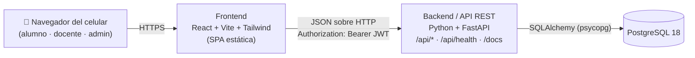
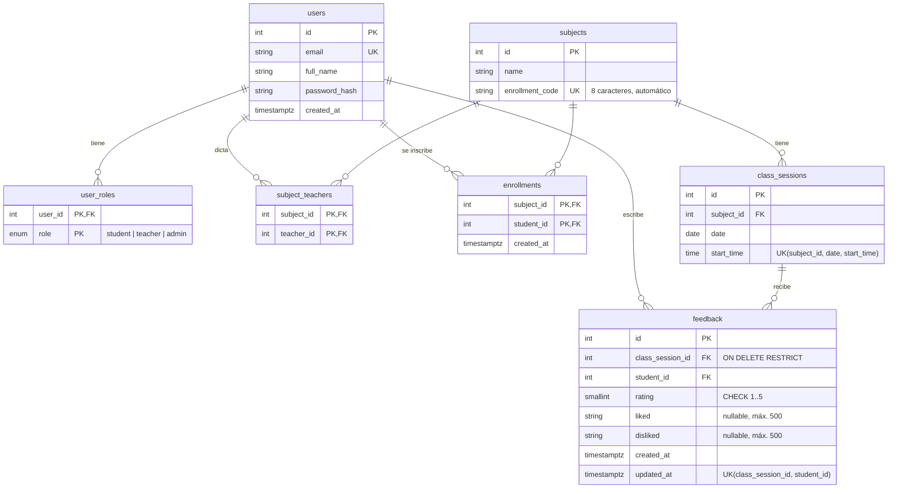

# Arquitectura: Feedback de clases

> **Versión inicial: escrita antes de programar** · 2026-10-20

## 1. Componentes



| Componente | Responsabilidad |
|------------|-----------------|
| **Frontend** | Pantallas mobile-first, login y registro, selector de rol, formularios y gráficos. Lee la URL de la API de `VITE_API_URL`. **No decide permisos**: solo oculta lo que no corresponde. |
| **Backend** | Autenticación (JWT), autorización por rol y por materia, **todas las reglas de negocio** (unicidad, plazos, anonimato, conflicto de interés), cálculo de promedios y tendencia, y documentación OpenAPI en `/docs`. |
| **Base de datos** | Persistencia. Refuerza las reglas críticas con restricciones: feedback único por (clase, alumno), nota entre 1 y 5, clase única por (materia, fecha, hora), y no se puede borrar una clase con feedback. |

Toda la configuración va por variables de entorno (`.env.example`): `DATABASE_URL`, `JWT_SECRET`, `CORS_ORIGINS`, `APP_TIMEZONE=America/Montevideo`, `FEEDBACK_WINDOW_DAYS=7` y `VITE_API_URL`.

## 2. Modelo de datos



**Glosario código ↔ dominio:** *subject* = materia, *class_session* = clase, *enrollment* = inscripción, *student / teacher / admin* = alumno / docente / administrador, *liked / disliked* = qué gustó / qué no gustó.

## 3. Roles, autorización y anonimato

- **Autenticación:** `POST /api/auth/login` devuelve un JWT firmado con `JWT_SECRET` (HS256, 8 h) que lleva el id del usuario. En cada request el backend vuelve a leer los roles del usuario desde la base, así que un cambio de rol aplica de inmediato.
- **Roles:** un usuario puede tener varios (`user_roles`). Cada grupo de endpoints (`/api/student`, `/api/teacher`, `/api/admin`) exige el rol correspondiente (si falta, 403). El "rol activo" es solo una vista del frontend.
- **Autorización por materia:** las consultas del docente siempre filtran con `JOIN subject_teachers ... WHERE teacher_id = <usuario autenticado>`. Una materia o clase ajena responde **404**, igual que una inexistente, para no revelar si existe. Lo mismo vale para el alumno con `enrollments`.
- **Anonimato (D-018, opción A):** `feedback.student_id` existe solo para la unicidad y para que el alumno edite el suyo. Las respuestas del docente usan un esquema Pydantic con **solo** `rating`, `liked` y `disliked`, en orden aleatorio, sin fechas. Hay pruebas automáticas que verifican que no aparezcan otros campos ni datos del alumno.
- **Plazo (D-022):** `fecha_clase ≤ hoy ≤ fecha_clase + FEEDBACK_WINDOW_DAYS`, donde "hoy" se calcula en `APP_TIMEZONE`. La misma regla vale para crear y para editar.

## 4. Endpoints principales (detalle completo en `/docs`)

| Método y ruta | Rol | Descripción |
|---------------|-----|-------------|
| `GET /api/health` | público | Estado del servicio y de la conexión a la base. |
| `POST /api/auth/register` · `POST /api/auth/login` · `GET /api/auth/me` | público / autenticado | Registro de alumno, login (JWT), usuario actual con sus roles. |
| `POST /api/student/enrollments` | alumno | Inscribirse con código (404 inválido, 409 ya inscripto o docente de la materia). |
| `GET /api/student/subjects` · `GET /api/student/subjects/{id}/classes` | alumno | Mis materias; clases con estado (`upcoming`, `open`, `closed`) y si ya tienen mi feedback. |
| `GET` · `POST` · `PUT /api/student/classes/{id}/feedback` | alumno | Ver, crear (409 si ya existe) y editar mi feedback (dentro del plazo). |
| `GET /api/teacher/subjects` · `GET /api/teacher/subjects/{id}/summary` | docente | Mis materias con su código; promedio y cantidad de respuestas por clase (tendencia). |
| `GET /api/teacher/classes/{id}/comments` | docente | Comentarios anónimos de una clase. |
| `GET` · `POST /api/admin/users` · `PUT /api/admin/users/{id}/roles` | admin | Gestión de cuentas y roles. |
| `GET` · `POST /api/admin/subjects` · `PUT /api/admin/subjects/{id}/teachers` | admin | Materias y docentes asignados. |
| `POST /api/admin/subjects/{id}/classes/generate` · `DELETE /api/admin/classes/{id}` | admin | Generar clases por calendario; eliminar una clase sin feedback. |

## 5. Estructura del repositorio (monorepo, D-001)

```
backend/    FastAPI: app/ (routers, models, schemas, services), alembic/, tests/
frontend/   React + Vite: src/ (pages, components, api)
docs/       DECISIONES, PROGRESO, REQUISITOS, ARQUITECTURA
docker-compose.yml   solo PostgreSQL para desarrollo local
```

## 6. Despliegue

**Pendiente: se define en la etapa de Kubernetes y Jenkins.**

## 7. Decisiones clave

Todas las decisiones, con sus alternativas y motivos, están en [`DECISIONES.md`](DECISIONES.md). Las más relevantes para esta arquitectura son D-018 (anonimato), D-022 (plazo), D-026 a D-028 (roles y clases) y D-031 a D-042 (stack y autenticación).
